# Tutorial Management System & Exploratory Data Analysis (EDA)

A Spring Boot REST API for managing tutorials, combined with an Exploratory Data Analysis (EDA) module for analyzing tutorial metadata, publication patterns, creator distribution, and title characteristics.

The project demonstrates backend development using **Java, Spring Boot, Spring Data JPA, DTOs, ModelMapper, Maven, and H2 Database**, alongside data analysis and visualization using Python and Jupyter Notebook.

[](https://www.oracle.com/java/)
[](https://spring.io/projects/spring-boot)
[](https://maven.apache.org/)
[](https://www.h2database.com/)
[](https://www.python.org/)
[](https://jupyter.org/)

**Repository:** [TutorialManagementSystemAndEDA](https://github.com/latenightcoder-git/TutorialManagementSystemAndEDA)


**Author:** Madhuchhanda Das  
**GitHub:** [@latenightcoder-git](https://github.com/latenightcoder-git)

---

## Table of Contents

- [Project Overview](#-project-overview)
- [Objectives](#-objectives)
- [Features](#-features)
- [Technology Stack](#-technology-stack)
- [System Architecture](#-system-architecture)
- [Project Structure](#-project-structure)
- [Code Navigation](#-code-navigation)
- [REST API Documentation](#-rest-api-documentation)
- [Database Configuration](#-database-configuration)
- [Sample Data Generation](#-sample-data-generation)
- [Exploratory Data Analysis](#-exploratory-data-analysis)
- [Output Screenshots](#-output-screenshots)
- [Installation and Setup](#-installation-and-setup)
- [Testing the API](#-testing-the-api)
- [Scope of the Project](#-scope-of-the-project)
- [Limitations](#-limitations)
- [Future Enhancements](#-future-enhancements)
- [Contributing](#-contributing)
- [Author](#-author)

---

## 📌 Project Overview

The Tutorial Management System is a backend application designed to manage tutorial records through RESTful APIs. Each tutorial contains information such as its title, description, publication status, and creator.

The application follows a layered architecture to separate HTTP request handling, business logic, data transfer, and database persistence.

An accompanying EDA module uses Python and Jupyter Notebook to explore tutorial-related data and generate visualizations that help identify patterns in titles, creators, and publication status.

The project combines two complementary components:

1. **Backend development:** Build and expose REST endpoints for tutorial management.
2. **Data analytics:** Explore tutorial metadata and produce graphical and tabular summaries.

## 🎯 Objectives

- Develop a RESTful backend using Spring Boot.
- Implement persistence with Spring Data JPA.
- Separate API request/response models from database entities using DTOs.
- Use ModelMapper to convert between entities and DTOs.
- Implement search operations using Spring Data JPA derived query methods.
- Generate sample tutorial records for development and analysis.
- Configure and inspect an H2 in-memory database.
- Perform EDA using Python, pandas, and visualization libraries like matplotlib, seaborn.
- Generate charts and CSV reports for further analysis.
- Practice organizing a Java application using maintainable architectural layers.

## ✨ Features

### Tutorial Management API

- Create tutorial records.
- Retrieve all tutorials.
- Retrieve a tutorial by its ID.
- Update existing tutorial records.
- Delete tutorials.
- Search by exact title.
- Filter tutorials by publication status.
- Search by creator.
- Search titles using case-insensitive partial matching.

### Backend Architecture

- Controller, service, repository, entity, and DTO separation.
- Spring Data JPA repository abstraction.
- ModelMapper-based object conversion.
- Optional-based handling of potentially missing records.
- Lombok annotations to reduce boilerplate code.
- Faker-based generation of sample tutorial data.

### EDA and Visualization

- Tutorial title-length distribution.
- Creator-wise tutorial distribution.
- Published versus unpublished tutorial analysis.
- Summary statistics and CSV output.
- Visual comparisons of tutorial metadata.

---

## 🛠️ Technology Stack

| Technology | Purpose |
|---|---|
| Java 25 | Primary backend programming language |
| Spring Boot 4.1.1 | Application configuration and REST backend |
| Spring Web MVC | HTTP request handling and REST controllers |
| Spring Data JPA | Repository abstraction and database operations |
| Hibernate | ORM and entity persistence |
| ModelMapper 3.2.4 | Entity-to-DTO and DTO-to-entity mapping |
| Lombok | Boilerplate reduction |
| Maven | Dependency and build management |
| H2 Database | Lightweight relational database |
| Oracle JDBC Driver | Runtime JDBC driver dependency for Oracle connectivity |
| Java Faker 1.0.2 | Synthetic sample-data generation |
| Python | EDA and data processing |
| Jupyter Notebook | Interactive analysis environment |
| pandas | Tabular data processing |
| Matplotlib / Seaborn | Data visualization, where used in the notebook |
| Git and GitHub | Version control and source-code hosting |

**Note:** The supplied configuration uses H2 as the active database. The Oracle JDBC dependency is included, but Oracle is not the active database in the shown configuration.

---

## 🏗️ System Architecture

The backend follows a layered architecture.

```text
                    Client / API Consumer
                             |
                             v
                   TutorialController
                   (REST Endpoints)
                             |
                             v
                    TutorialService
                   (Service Interface)
                             |
                             v
                  TutorialServiceImpl
                   (Business Logic)
                             |
                    +--------+--------+
                    |                 |
                    v                 v
                ModelMapper     TutorialRepository
                    |           (Spring Data JPA)
                    |                 |
                    v                 v
               TutorialDto       Tutorial Entity
                                      |
                                      v
                                  H2 Database


       Separate Analytics Component

       Tutorial Metadata / Dataset
                    |
                    v
              Jupyter Notebook
                    |
                    v
          Data Cleaning and Analysis
                    |
                    v
           Charts, Statistics, CSV
```

### Layer Responsibilities

| Layer | Responsibility |
|---|---|
| Controller | Exposes REST endpoints and processes HTTP requests |
| Service Interface | Defines operations supported by the application |
| Service Implementation | Contains business logic and coordinates persistence |
| DTO | Represents data transferred between the API and clients |
| Entity | Represents the tutorial database record |
| Repository | Provides CRUD operations and derived search queries |
| ModelMapper | Converts objects between entity and DTO representations |
| DataLoader | Generates and saves synthetic tutorial records at startup |
| EDA Notebook | Analyzes tutorial metadata and produces reports and charts |

### Request Processing Flow

For a typical API request:

1. The client sends an HTTP request to a controller endpoint.
2. The controller delegates the operation to the service layer.
3. The service uses ModelMapper when conversion between DTOs and entities is required.
4. The repository retrieves or persists entity objects.
5. The service converts the result into a DTO.
6. The controller returns the API response to the client.

This separation helps isolate persistence logic from API representation and business operations.

---

## 📂 Project Structure

The repository contains a Spring Boot application and a separate EDA workspace.

```text
TutorialManagementSystemAndEDA/
│
├── .mvn/
│
├── src/
│   ├── main/
│   │   ├── java/
│   │   │   └── com/
│   │   │       └── example/
│   │   │           ├── config/
│   │   │           │   └── DataLoader.java
│   │   │           │
│   │   │           ├── controller/
│   │   │           │   └── TutorialController.java
│   │   │           │
│   │   │           ├── dto/
│   │   │           │   └── TutorialDto.java
│   │   │           │
│   │   │           ├── entity/
│   │   │           │   └── Tutorial.java
│   │   │           │
│   │   │           ├── repository/
│   │   │           │   └── TutorialRepository.java
│   │   │           │
│   │   │           └── service/
│   │   │               ├── TutorialService.java
│   │   │               └── impl/
│   │   │                   └── TutorialServiceImpl.java
│   │   │
│   │   └── resources/
│   │       ├── application.properties
│   │       └── application_oracle.properties
│   │
│   └── test/
└── Output_Images/
│    ├── browser.png
│    ├── createTutorial.png
│    ├── deleteTutorial.png
│    ├── EDA_1.png
│    ├── EDA_2.png
│    ├── EDA_3.png
│    ├── getAllTutorials.png
│    ├── getTutorialById.png
│    ├── getByCreator.png
│    ├── getByPublished.png
│    ├── getByTitle_1.png
│    ├── getByTitle_2.png
│    ├── getByTitleContainingIgnoreCase.png
│    ├── H2_Console.png
│    ├── Picking_data_by_pd.read_json.png
│    ├── Save_Analysis_Summaries_Reports.png
│    ├── updateTutorial.png
│    ├── Visualization_1.png
│    ├── Visualization_2.png
│    ├── Visualization_3.png
│    └── Visualization_4.png
├── EDA/
│   └── codes/
│       ├── TutorialManagementSystemEDA.ipynb
│       └── eda_outputs/
│           ├── creator_vs_published.png
│           ├── publication_distribution.png
│           ├── summary_report.csv
│           ├── title_length_distribution.png
│           └── top_creators.png
│
├── pom.xml
└── README.md
```

*The tree illustrates the principal files visible in the repository; additional files may exist.*

---

## 🧭 Code Navigation

Use these links to navigate directly to the implementation.

### Backend source code

| Component | Description | Source |
|---|---|---|
| Controller | REST API endpoints | [TutorialController.java](https://github.com/latenightcoder-git/TutorialManagementSystemAndEDA/tree/main/src/main/java/com/example/controller/TutorialController.java) |
| DTO | API data-transfer model | [TutorialDto.java](https://github.com/latenightcoder-git/TutorialManagementSystemAndEDA/blob/main/src/main/java/com/example/dto/TutorialDto.java) |
| Entity | Tutorial persistence model | [Tutorial.java](https://github.com/latenightcoder-git/TutorialManagementSystemAndEDA/blob/main/src/main/java/com/example/entity/Tutorial.java) |
| Repository | Database operations and search queries | [TutorialRepository.java](https://github.com/latenightcoder-git/TutorialManagementSystemAndEDA/blob/main/src/main/java/com/example/repository/TutorialRepository.java) |
| Service contract | Service method definitions | [TutorialService.java](https://github.com/latenightcoder-git/TutorialManagementSystemAndEDA/tree/main/src/main/java/com/example/service/TutorialService.java) |
| Service implementation | Business logic and DTO mapping | [service/impl/TutorialServiceImpl.java](https://github.com/latenightcoder-git/TutorialManagementSystemAndEDA/tree/main/src/main/java/com/example/service/impl/TutorialServiceImpl.java) |
| Sample data | Faker-based data generation | [DataLoader.java](https://github.com/latenightcoder-git/TutorialManagementSystemAndEDA/blob/main/src/main/java/com/example/config/DataLoader.java) |
| Application configuration | Port and H2 database settings | [application.properties](https://github.com/latenightcoder-git/TutorialManagementSystemAndEDA/blob/main/src/main/resources/application.properties) |
| Oracle configuration | Alternative database configuration | [application_oracle.properties](https://github.com/latenightcoder-git/TutorialManagementSystemAndEDA/blob/main/src/main/resources/application_oracle.properties) |
| Maven configuration | Dependencies and build plugins | [pom.xml](https://github.com/latenightcoder-git/TutorialManagementSystemAndEDA/blob/main/pom.xml) |

### EDA source code and generated outputs

| Resource | Description | Link |
|---|---|---|
| Jupyter Notebook | Main EDA implementation | [TutorialManagementSystemEDA.ipynb](https://github.com/latenightcoder-git/TutorialManagementSystemAndEDA/blob/main/EDA/codes/TutorialManagementSystemEDA.ipynb) |
| Output directory | Generated charts and report | [eda_outputs](https://github.com/latenightcoder-git/TutorialManagementSystemAndEDA/tree/main/EDA/codes/eda_outputs) |
| Creator analysis | Creator and publication comparison | [creator_vs_published.png](EDA/codes/eda_outputs/creator_vs_published.png) |
| Publication analysis | Publication-status distribution | [publication_distribution.png](EDA/codes/eda_outputs/publication_distribution.png) |
| Title analysis | Title-length distribution | [title_length_distribution.png](EDA/codes/eda_outputs/title_length_distribution.png) |
| Top creators | Creator-wise comparison | [top_creators.png](EDA/codes/eda_outputs/top_creators.png) |
| Summary report | Tabular analysis results | [summary_report.csv](EDA/codes/eda_outputs/summary_report.csv) |

---

## 🌐 REST API Documentation

**Base URL:** `http://localhost:8888`

The Tutorial Management System exposes RESTful endpoints to create, retrieve, update, delete, and search tutorial records. The API uses JSON for request and response bodies where applicable.

### 1. Create a Tutorial

Creates a new tutorial record and assigns an ID generated by the database.

- **Method:** `POST`
- **Endpoint:** `/api`
- **Content-Type:** `application/json`
- **Expected Response:** `201 Created`

**Example Request:**

```http
POST http://localhost:8888/api
Content-Type: application/json
```

```json
{
  "title": "Spring Boot REST API",
  "description": "Introduction to building RESTful services",
  "published": true,
  "creator": "Madhuchhanda Das"
}
```

**Output Screenshot:**

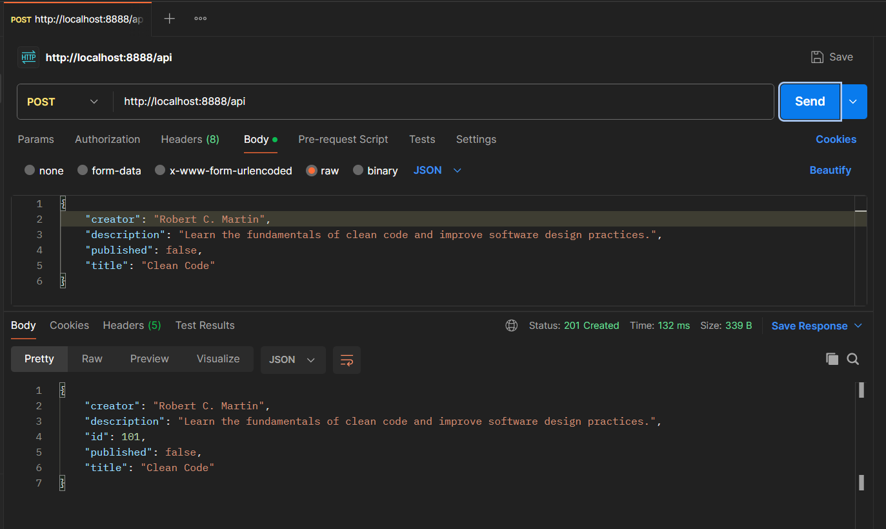

---

### 2. Retrieve All Tutorials

Retrieves all saved tutorial records as a list of DTOs.

- **Method:** `GET`
- **Endpoint:** `/api/all`
- **Expected Response:** `200 OK`

**Example Request:**

```http
GET http://localhost:8888/api/all
```

**Output Screenshot:**

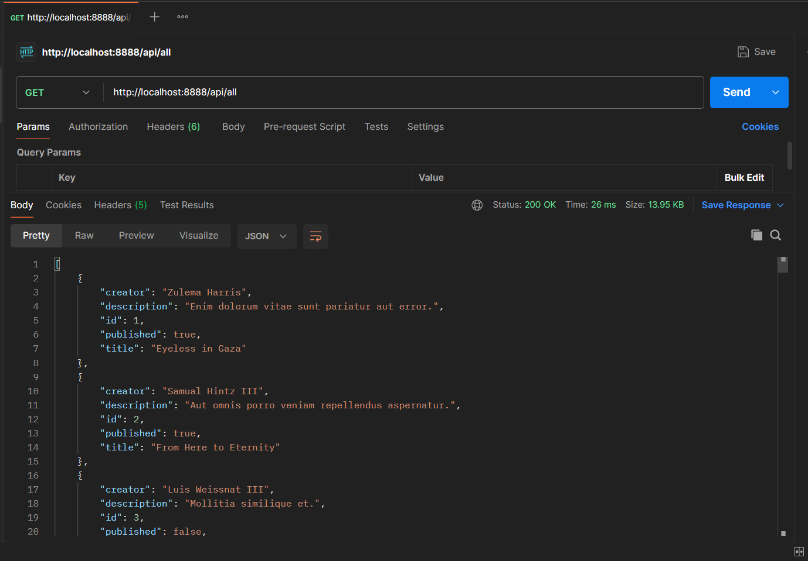

---

### 3. Retrieve a Tutorial by ID

Retrieves a specific tutorial using its unique database identifier.

- **Method:** `GET`
- **Endpoint:** `/api/{id}`
- **Expected Response:** `200 OK` if found; `404 Not Found` if missing, provided the controller handles missing records accordingly.

**Example Request:**

```http
GET http://localhost:8888/api/96
```

**Output Screenshot:**

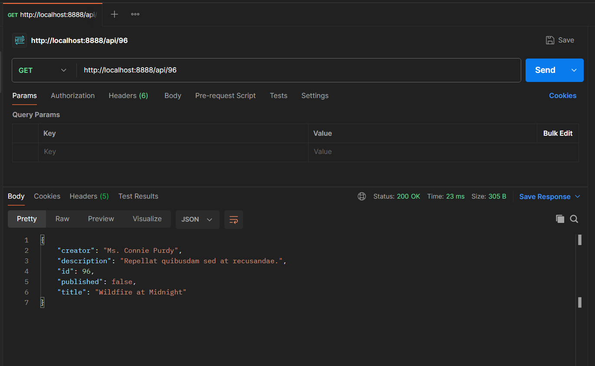

---

### 4. Update a Tutorial

Updates the title, description, publication status, and creator of an existing tutorial identified by its ID.

- **Method:** `PUT`
- **Endpoint:** `/api/{id}`
- **Content-Type:** `application/json`
- **Expected Response:** `200 OK` if updated successfully; `404 Not Found` if the record does not exist and the controller maps that case appropriately.

**Example Request:**

```http
PUT http://localhost:8888/api/101
Content-Type: application/json
```

```json
{
  "title": "Advanced Spring Boot",
  "description": "REST APIs, JPA, and persistence",
  "published": true,
  "creator": "Madhuchhanda Das"
}
```

**Output Screenshot:**

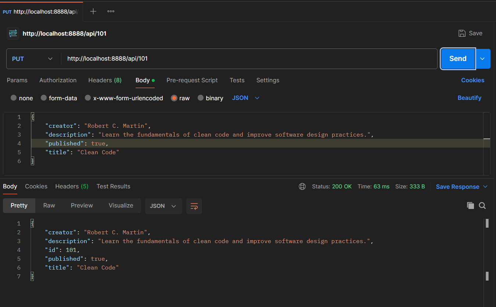

---

### 5. Delete a Tutorial

Deletes the tutorial associated with the specified ID.

- **Method:** `DELETE`
- **Endpoint:** `/api/{id}`
- **Expected Response:** `200 OK` with a success message, according to the described controller behavior.

**Example Request:**

```http
DELETE http://localhost:8888/api/101
```

**Output Screenshot:**

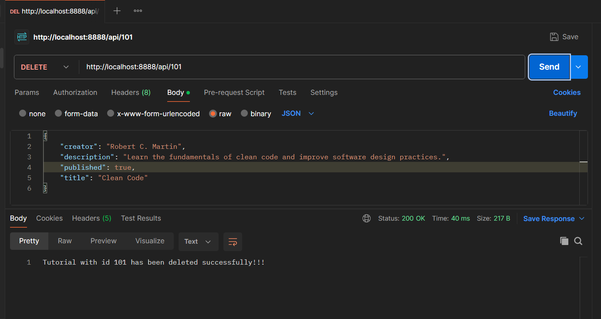

---

### 6. Search by Exact Title

Retrieves tutorials matching the specified title using the repository's exact-title query method.

- **Method:** `GET`
- **Endpoint:** `/api/title?title={title}`
- **Expected Response:** `200 OK`

**Example Request:**

```http
GET http://localhost:8888/api/title?title=Spring%20Boot%20REST%20API
```

The `title` parameter should be URL-encoded when it contains spaces or special characters.

**Output Screenshot:**

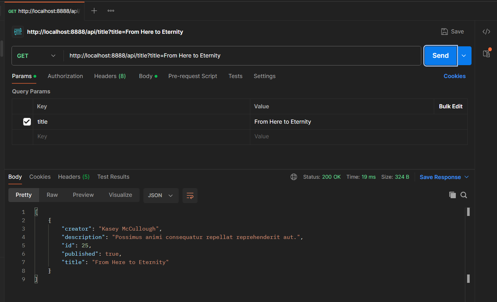
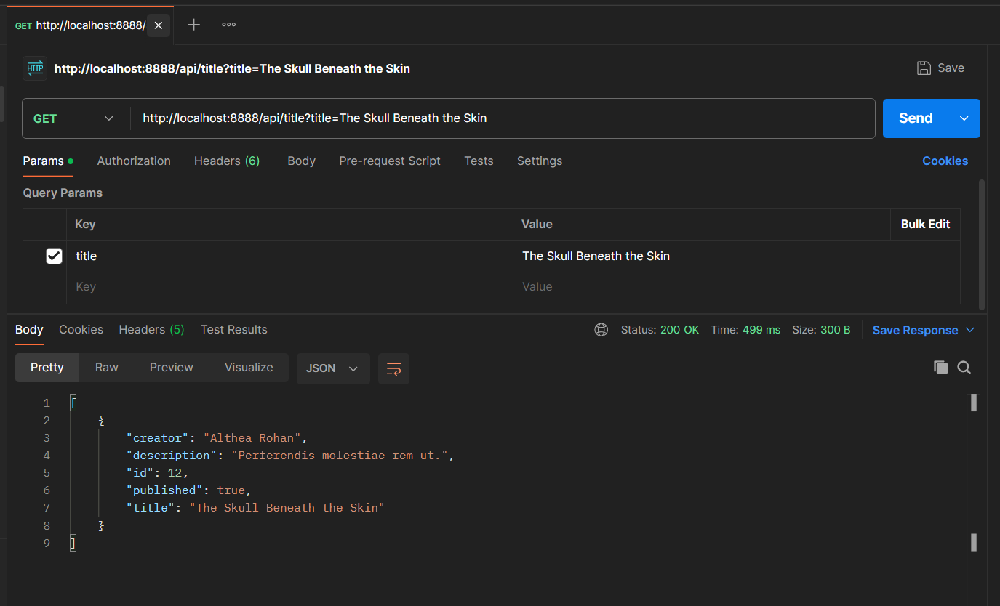
---

### 7. Search by Partial Title

Finds tutorials whose titles contain the specified keyword, ignoring differences in letter case.

- **Method:** `GET`
- **Endpoint:** `/api/titlewithwords?word={keyword}`
- **Expected Response:** `200 OK`

**Example Request:**

```http
GET http://localhost:8888/api/titlewithwords?word=spring
```

This endpoint uses the repository method `findByTitleContainingIgnoreCase(String title)`.

**Output Screenshot:**

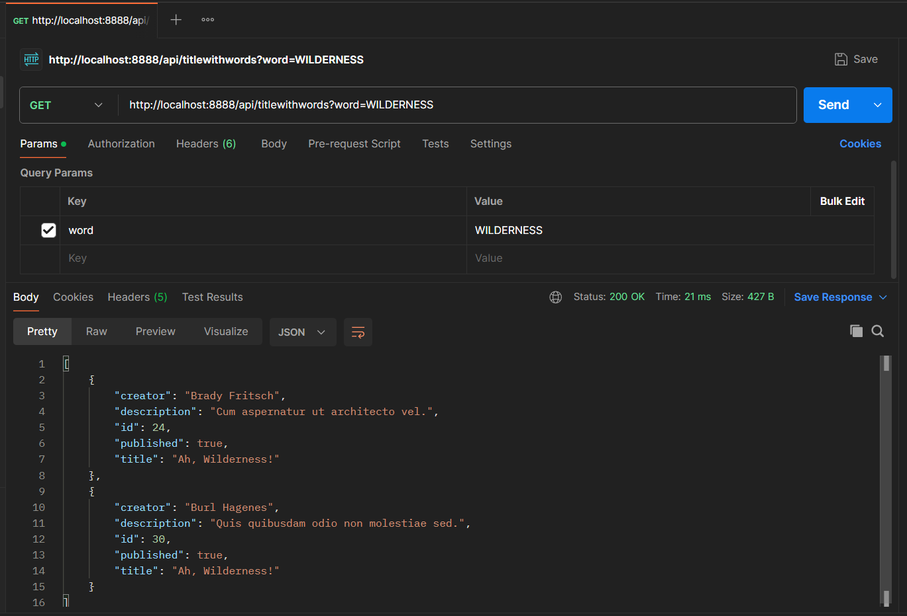

---

### 8. Filter by Publication Status

Retrieves tutorials according to their publication status.

- **Method:** `GET`
- **Endpoint:** `/api/published?published={boolean}`
- **Expected Response:** `200 OK`

**Example Requests:**

```http
GET http://localhost:8888/api/published?published=true
```

```http
GET http://localhost:8888/api/published?published=false
```

The `published` query parameter accepts `true` or `false`.

**Output Screenshot:**

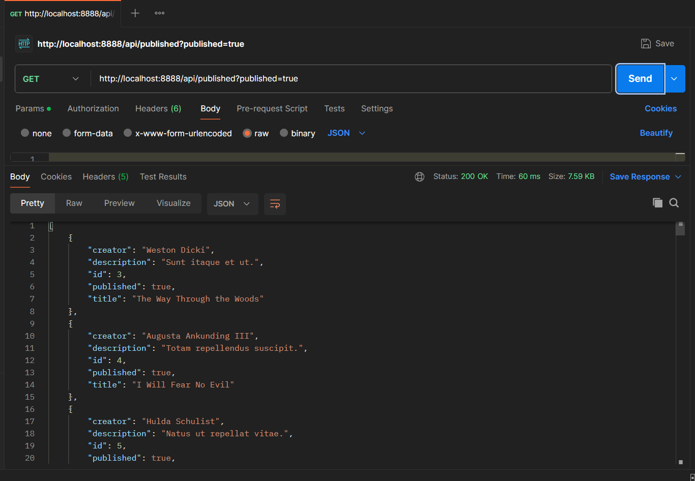

---

### 9. Search by Creator Name

Retrieves tutorials matching the specified creator name.

- **Method:** `GET`
- **Endpoint:** `/api/creator?creator={name}`
- **Expected Response:** `200 OK`

**Example Request:**

```http
GET http://localhost:8888/api/creator?creator=Madhuchhanda%20Das
```

**Output Screenshot:**

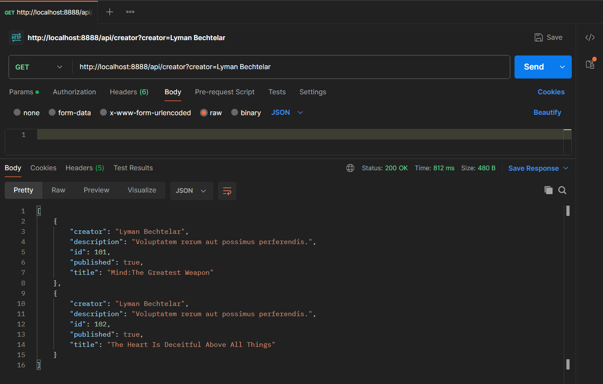

---

## 10. Verify Base Server Endpoint via Browser
Confirms that the Spring Boot application server is up, running, and accessible at the root API path via a standard web browser interface.

* **Method:** `GET`
* **Endpoint:** `/`
* **Expected Response:** `200 OK`

**Output Screenshot:**

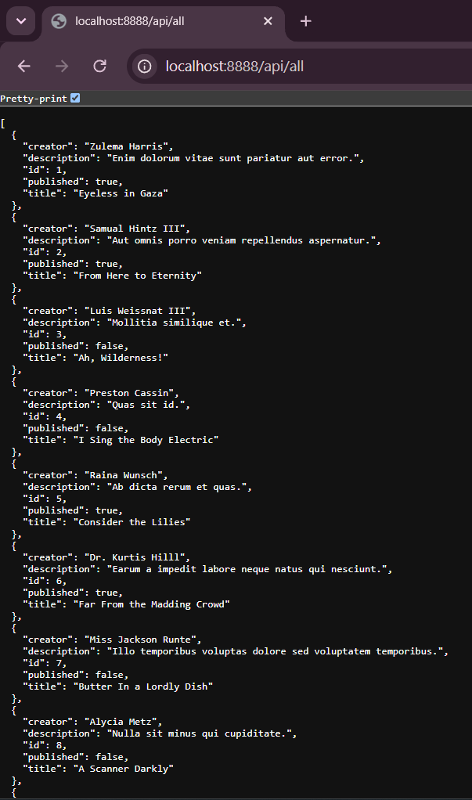

---

## 11. Database Management via H2 Console
Provides a direct web-based console interface to inspect underlying database schemas, execute raw SQL statements, and check tutorial table persistence state during development.

* **Method:** `GET`
* **Endpoint:** `/h2`
* **Expected Response:** `200 OK` (Renders the interactive H2 Database login configuration panel)

**Output Screenshot:**

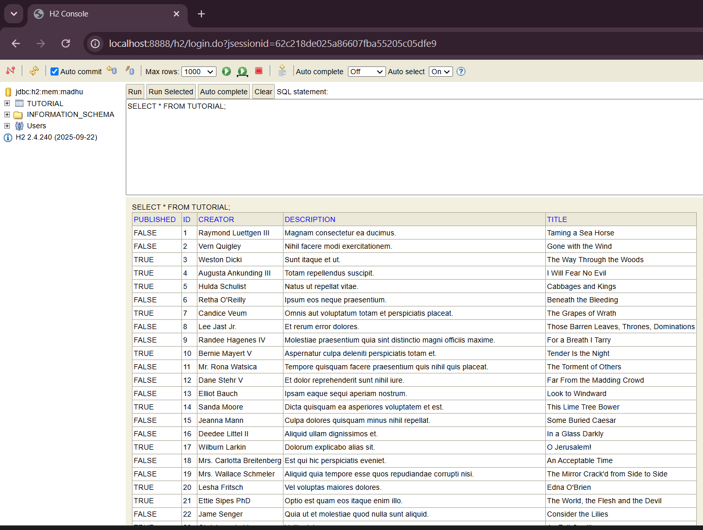

---

## 12. Data Hygiene & Structural Inspection (EDA Phase 1)
Initiates the exploratory data analysis notebook workspace by providing a structural overview of the project. It maps out the key analytical components including data hygiene evaluation, publication status distributions, author metrics, and content-length profiles. This initial segment handles importing all core environment packages required to execute the pipeline.

* **Analysis Focus:** Outlining the exploratory architecture and preparing code modules for downstream evaluation.
* **Libraries Loaded:** Core data management and visualization modules including `json`, `requests`, `numpy`, `pandas`, `matplotlib.pyplot`, `pathlib.Path`, `IPython.display`, and `textwrap`.

**Output Screenshot:**

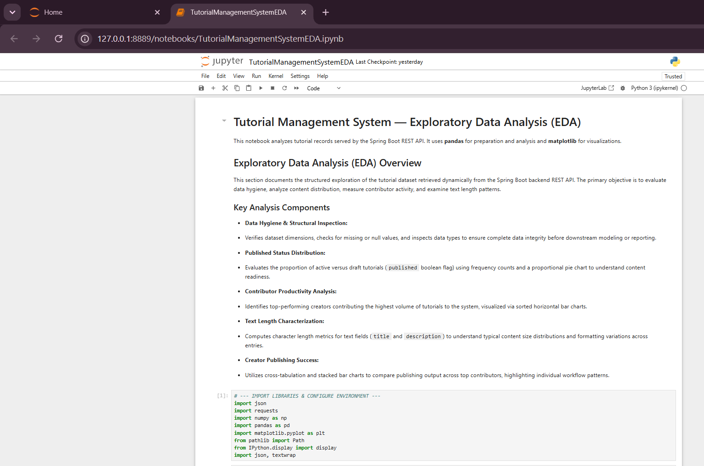

---

## 13. Dynamic REST API JSON Ingestion
Demonstrates the initialization phase inside the Jupyter Notebook environment using the `pd.read_json()` engine to fetch live tutorial arrays directly from the Spring Boot server pipeline.

* **Method:** Data Extraction Script
* **Implementation Engine:** Pandas DataFrame Parsers (`df = pd.read_json("http://localhost:8888/api/all")`)
* **Expected Result:** Renders structural dimension properties (`Dataset shape: (100, 5)`) along with standard column indexing parameters.
* **Core Methods Utilized:** Quality assessment and summary methods including `df.copy()`, `df.columns`, `df.dtypes`, `df.isnull().sum()`, `df.duplicated().sum()`, and `df.describe(include="all")`.

**Output Screenshot:**

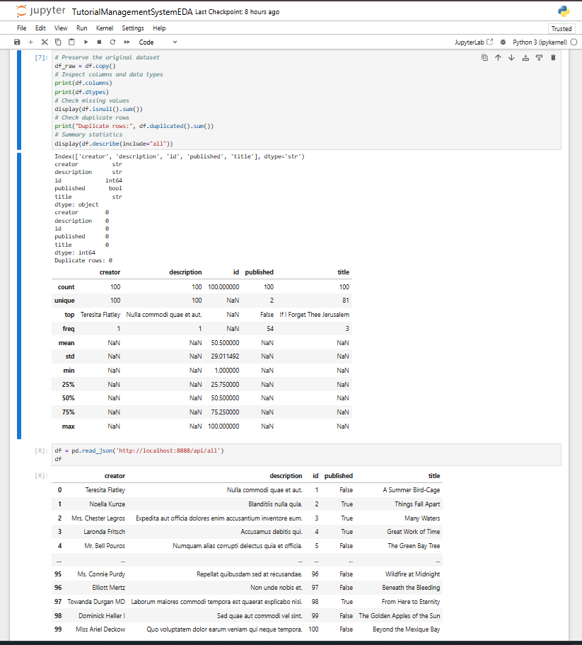

---

## 14. Descriptive Statistics Profiling (EDA Phase 2)
Handles the data ingestion process and executes an initial structural audit of the retrieved dataset. It connects to a REST API endpoint to dynamically load records into a structured format before running diagnostic checks on dimension size, data integrity, and column schemas to establish a baseline for downstream statistical profiling.

* **Analysis Focus:** Identifying core structural properties, validating missing values, and inspecting column data types.
* **Core Methods Utilized:** Ingestion and diagnostic methods including `pd.read_json()`, `df.shape`, `df.head()`, and `df.info()`.

**Output Screenshot:**

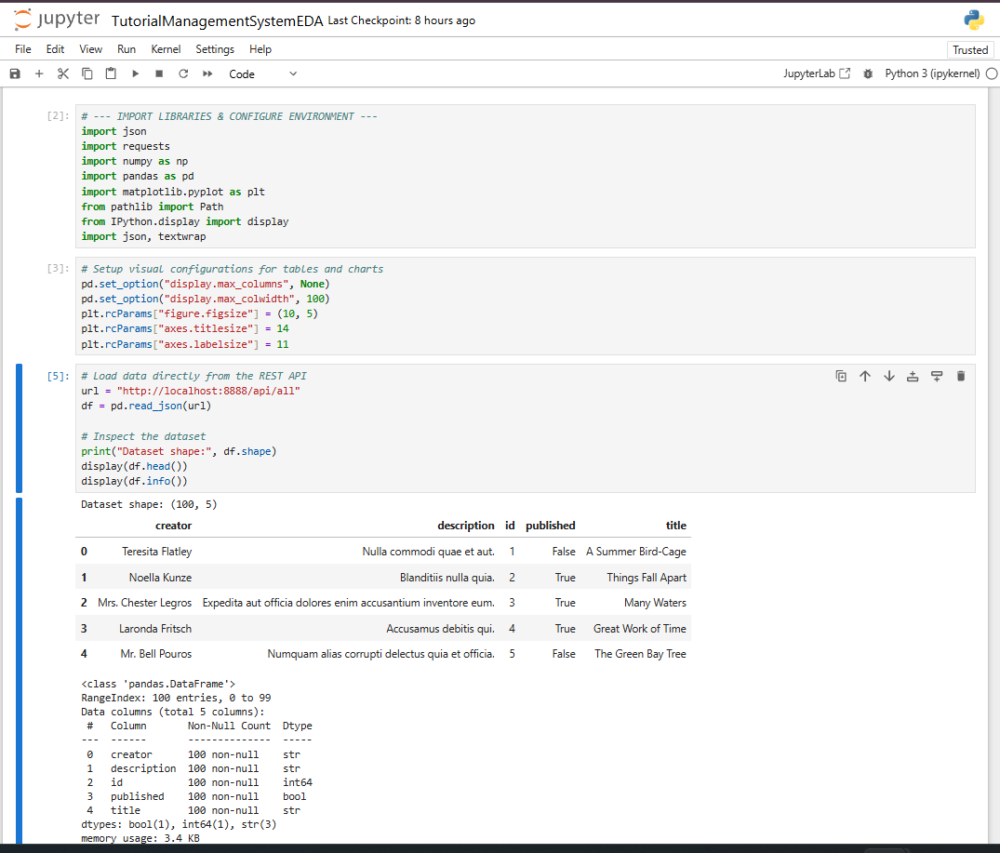

---

## 15. Data Quality Auditing & Summary Statistics (EDA Phase 3)
Executes a rigorous quality audit and comprehensive statistical profiling on the active dataset. This phase preserves a baseline copy of the dataset before systematically scanning for structural metadata, null distributions, duplicate row counts, and detailed descriptive statistics across both numerical and categorical features.

* **Analysis Focus:** Validating missing value counts, detecting duplicate observations, and evaluating high-level distribution metrics.
* **Core Methods Utilized:** Quality assessment and summary methods including `df.copy()`, `df.columns`, `df.dtypes`, `df.isnull().sum()`, `df.duplicated().sum()`, and `df.describe(include="all")`.

**Output Screenshot:**

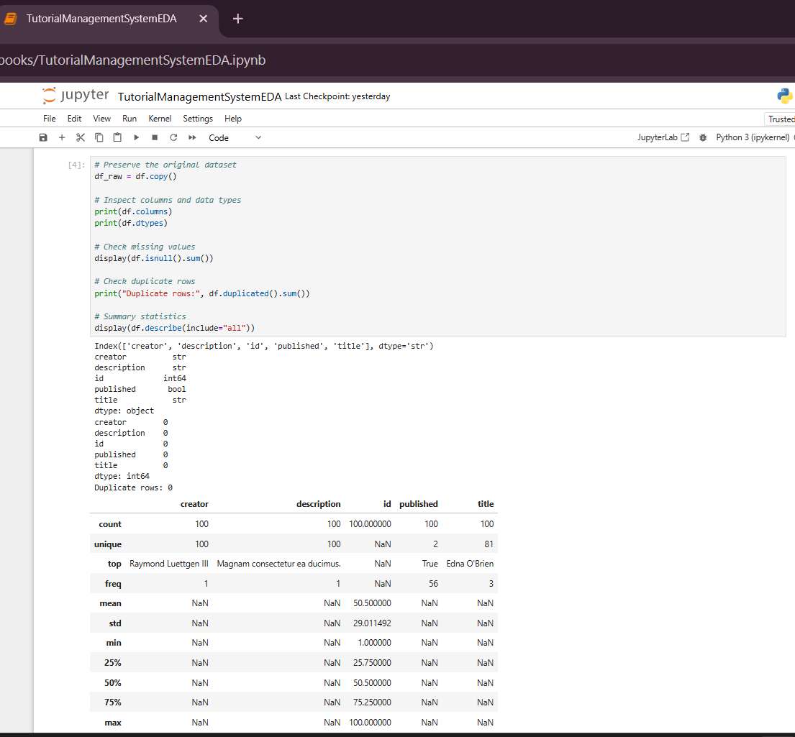

---

## 16. Published Status Distribution Analysis (Visualization 1)
Renders a custom proportional visual representation evaluating the ratio of active public modules against pending draft logs saved inside the dataset matrix.

* **Chart Variety:** Matte Pie Chart with precise string percentages.
* **Data Insight Breakdown:** 56.0% True (Published Tutorials) vs. 44.0% False (Draft Tutorials).

**Output Screenshot:**

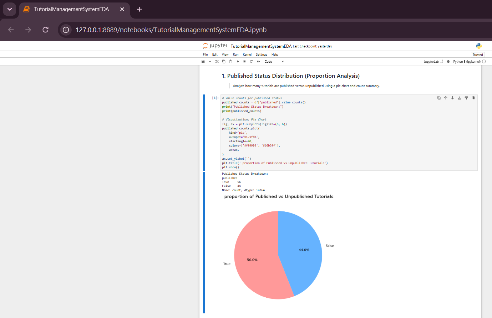

---

## 17. Contributor Productivity Analysis (Visualization 2)
Renders a horizontal ranking model mapping system workloads to determine which individual creators have submitted the largest concentration of materials.

* **Chart Variety:** Ordered Horizontal Bar Chart.
* **Data Insight Breakdown:** Isolates individual volume trends across top-tier authors such as Bernie Mayert V, Randee Hagenes IV, and Lee Jast Jr.

**Output Screenshot:**

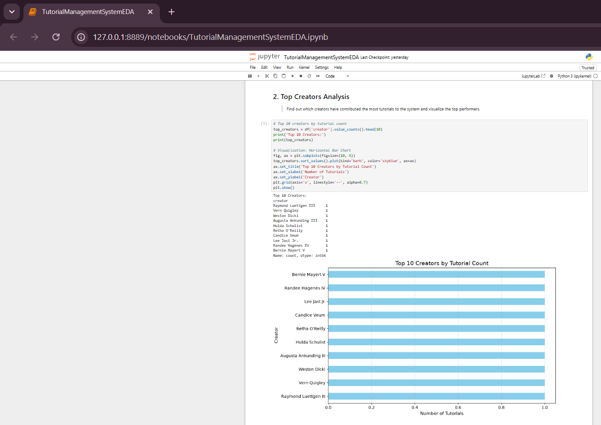

---

## 18. Character Content Size Profiles (Visualization 3)
Plots side-by-side distribution panels to inspect the layout uniformity, wordiness, and character limits across the textual column arrays.

* **Chart Variety:** Dual Histogram Grid overlayed with Edge Borders.
* **Data Insight Breakdown:** Separates explicit density intervals for title characters (peaking between 15-20) versus description characters (peaking between 25-40).

**Output Screenshot:**

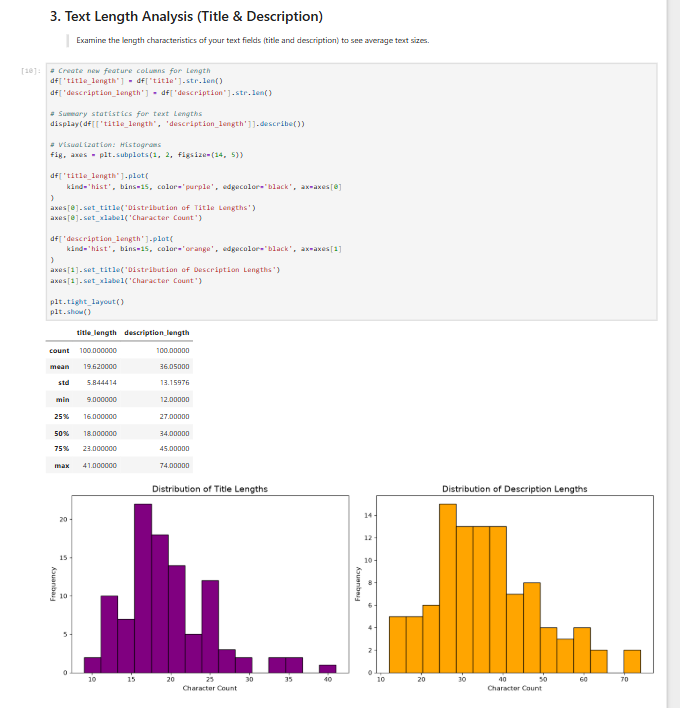

---

## 19. Workflow Split Comparisons Across Top Creators (Visualization 4)
Cross-tabulates user productivity scores against their specific staging environments to track single-author deployment patterns.

* **Chart Variety:** Stacked 100% Proportional Bar Chart paired with cross-tabulation tables.
* **Data Insight Breakdown:** Directly highlights distinct author behavioral profiles (e.g., Augusta Ankunding III works completely on Published items, whereas Lee Jast Jr. maintains entirely Unpublished files).

**Output Screenshot:**

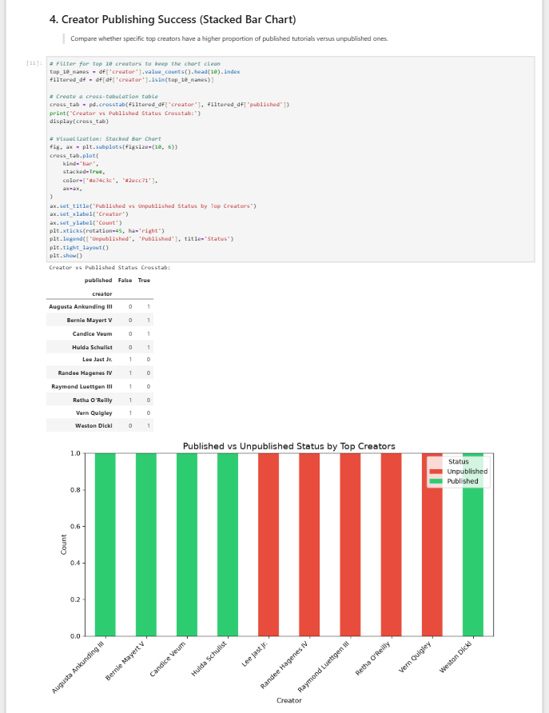

---

## 20. System Summarized Analytics Export
Logs the target commands executed at the conclusion of the notebook session to automatically save dataframes, summary metrics, and text distributions directly onto the secondary workstation storage disk.

* **Method:** File Export Execution
* **Output Path Target:** `/eda_outputs/` directory pipeline
* **Expected Result:** Success confirmation banner string printed cleanly beneath the execution cell block.

**Output Screenshot:**

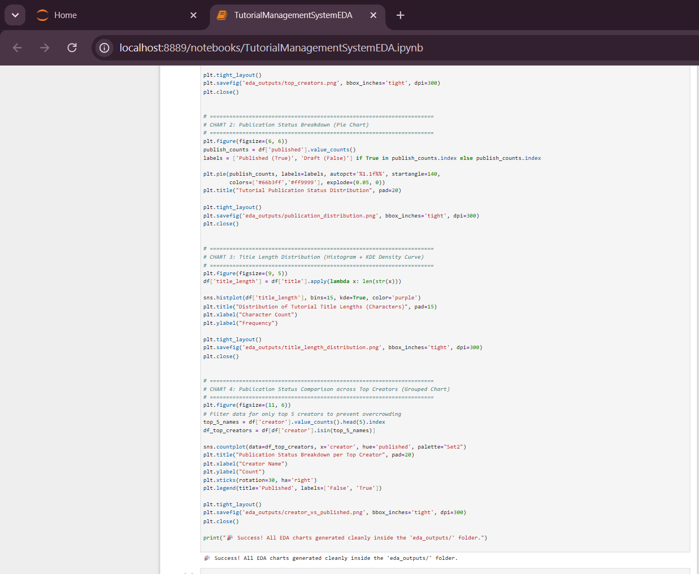

---

## 📋 REST API Endpoint Summary

| Operation | HTTP Method | Endpoint | Verification Screenshot |
|---|---|---|---|
| Create tutorial | `POST` | `/api` | [createTutorial.png](Output_Images/createTutorial.png) |
| Retrieve all tutorials | `GET` | `/api/all` | [getAllTutorials.png](Output_Images/getAllTutorials.png) |
| Retrieve tutorial by ID | `GET` | `/api/{id}` | [getTutorialById.png](Output_Images/getByTitle_1.png) |
| Update tutorial | `PUT` | `/api/{id}` | [updateTutorial.png](Output_Images/updateTutorial.png) |
| Delete tutorial | `DELETE` | `/api/{id}` | [deleteTutorial.png](Output_Images/deleteTutorial.png) |
| Search by exact title | `GET` | `/api/title?title={title}` | [getByTitle_1.png](Output_Images/getByTitle_1.png) |
| Search by partial title | `GET` | `/api/titlewithwords?word={keyword}` | [getByTitleContainingIgnoreCase.png](Output_Images/getByTitleContainingIgnoreCase.png) |
| Filter by publication status | `GET` | `/api/published?published={boolean}` | [getByPublished.png](Output_Images/getByPublished.png) |
| Search by creator | `GET` | `/api/creator?creator={name}` | [getByCreator.png](Output_Images/getByCreator.png) |

**Note:** All endpoints use `http://localhost:8888` as the base URL during local execution. Actual HTTP status codes depend on the controller implementation and its exception-handling logic.

---

## 🗄️ H2 Database Console

The application uses an H2 in-memory database for tutorial persistence during execution.

- **Console URL:** `http://localhost:8888/h2`
- **JDBC URL:** `jdbc:h2:mem:madhu`
- **Username:** `sa`
- **Password:** Leave blank, unless you have changed the configuration.

**Output Screenshot:**


---

## 📊 Exploratory Data Analysis (EDA) Outputs

The project also includes a Jupyter Notebook for analyzing tutorial metadata and generating data visualizations.

### EDA Notebook Outputs


### Data Visualizations


### Data Processing and Summary Reports


These screenshots document the notebook execution, data processing, generated reports, and visualization outputs.

---

## 🖥️ Application in Browser

The following screenshot demonstrates the application running locally.


---

## 🗄️ Database Configuration

The application is configured to use an H2 in-memory database.

Relevant configuration from `application.properties`:

```properties
spring.application.name=TutorialManagementSystemAndEDA
server.port=8888

spring.datasource.username=sa
spring.datasource.password=
spring.datasource.url=jdbc:h2:mem:madhu
spring.datasource.driverClassName=org.h2.Driver

spring.h2.console.path=/h2
spring.h2.console.enabled=true
spring.h2.console.settings.web-allow-others=true

spring.jpa.show-sql=true
spring.jpa.properties.hibernate.format_sql=true
spring.jpa.database-platform=org.hibernate.dialect.H2Dialect
spring.jpa.hibernate.ddl-auto=create
```

### Accessing the H2 Console

1. Start the Spring Boot application.
2. Open `http://localhost:8888/h2` in your browser.
3. Enter the JDBC URL:

   ```text
   jdbc:h2:mem:madhu
   ```

4. Enter username `sa`.
5. Leave the password empty.
6. Connect and inspect the generated tutorial table.

### Database Lifecycle

The current configuration uses:

```properties
spring.jpa.hibernate.ddl-auto=create
```

Hibernate creates the database schema when the application starts. Existing schema data is not intended to persist across application restarts.

The configured database is in-memory:

```text
jdbc:h2:mem:madhu
```

Therefore, tutorial records are lost when the application shuts down. For durable storage, configure a file-based H2 database or a production database such as Oracle or PostgreSQL.

**Security note:** The H2 console is enabled, and `web-allow-others=true` permits access beyond localhost when network and application settings allow it. This should not be enabled indiscriminately in a public deployment.

---

## 🧪 Sample Data Generation

The application includes `DataLoader.java`, which implements Spring Boot's `CommandLineRunner`.

At application startup, it creates 100 synthetic tutorial records using Java Faker.

```java
for (int i = 0; i < 100; i++) {
    Tutorial tutorial = new Tutorial(
        faker.book().title(),
        faker.lorem().sentence(),
        faker.bool().bool(),
        faker.name().fullName()
    );

    tutorialRepository.save(tutorial);
}
```

Each generated record contains:

- A randomly generated title.
- A sample description.
- A random Boolean publication status.
- A generated creator name.

The records support local API testing and development. They are synthetic data, not real user-generated tutorial records.

---

## 📊 Exploratory Data Analysis (EDA)

The repository includes a Jupyter Notebook dedicated to analyzing tutorial metadata.

**Notebook:** [TutorialManagementSystemEDA.ipynb](https://github.com/latenightcoder-git/TutorialManagementSystemAndEDA/blob/main/EDA/codes/TutorialManagementSystemEDA.ipynb)

The generated output directory contains the following artifacts.

### 1. Publication Distribution

**File:** `publication_distribution.png`

Examines the distribution of published and unpublished tutorials.

Potential uses:

- Compare the number of published and unpublished records.
- Understand the overall publication-status balance.
- Identify a dataset dominated by one publication category.

### 2. Creator vs. Publication Status

**File:** `creator_vs_published.png`

Compares creator-level tutorial contributions with publication status.

Potential uses:

- Explore publication patterns across creators.
- Compare published and unpublished tutorial counts.
- Identify differences in creator activity.

### 3. Title-Length Distribution

**File:** `title_length_distribution.png`

Examines the distribution of tutorial title lengths.

Potential uses:

- Understand common title lengths.
- Identify unusually short or long titles.
- Inform future title-quality or metadata analysis.

### 4. Top Creators

**File:** `top_creators.png`

Visualizes the creators contributing the highest number of tutorial records.

Potential uses:

- Identify the most frequent contributors.
- Compare creator activity.
- Explore concentration in the dataset.

### 5. Summary Report

**File:** `summary_report.csv`

Contains tabular analysis results generated by the notebook. Consult the CSV headers for the exact metrics and statistics included.

These analyses describe patterns in the available dataset; they do not, by themselves, establish causation or real-world creator performance.

---

## 🖼️ Output Screenshots

The following Images show the H2 console, testing all rest api endpoints in postman 


The following images are generated by the EDA notebook and stored in `EDA/codes/eda_outputs/`.

### Publication Distribution

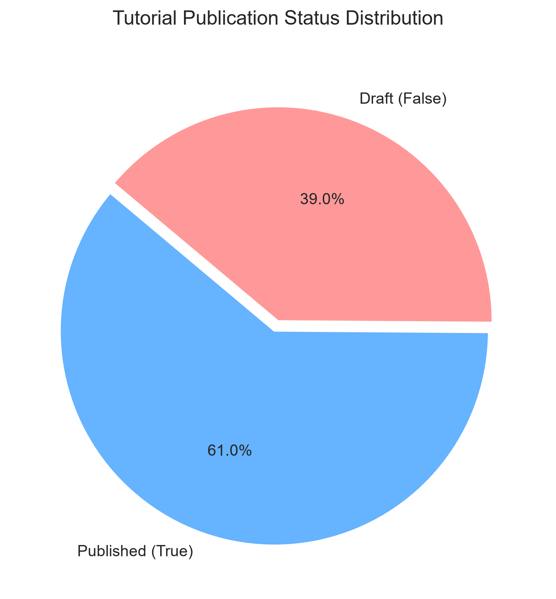

### Creator vs. Publication Status

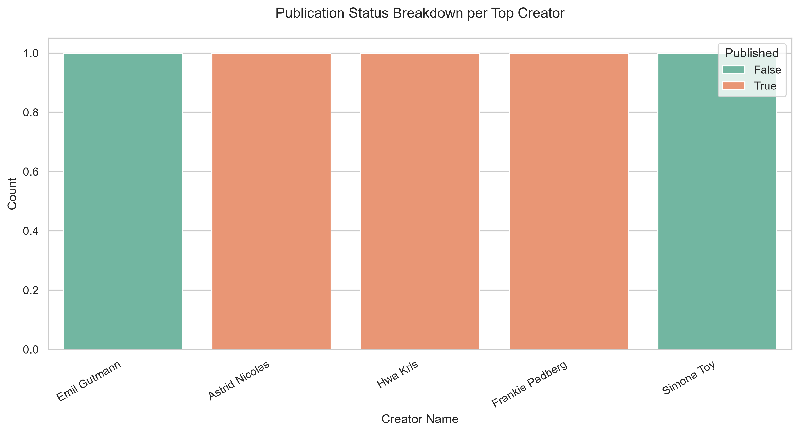

### Title-Length Distribution

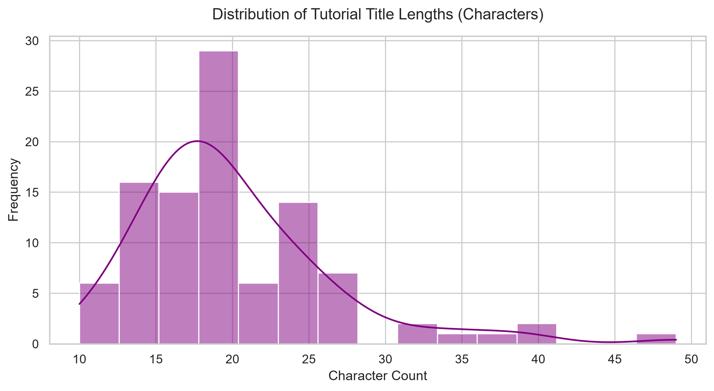

### Top Creators

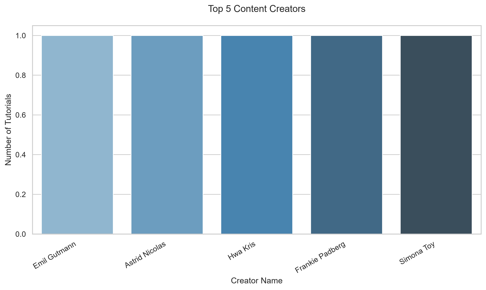

### Summary Report

View the generated [summary_report.csv](EDA/codes/eda_outputs/summary_report.csv).

**API testing screenshots:** Additional screenshots from Postman, browser requests, or the H2 console can be added here when available. The current screenshot section documents the generated EDA outputs rather than claiming that API response screenshots have already been committed.

---

## 🚀 Installation and Setup

### Prerequisites

Install the following tools before running the project:

- [JDK 25](https://www.oracle.com/java/technologies/downloads/)
- [Apache Maven](https://maven.apache.org/download.cgi), or use the included Maven Wrapper if available
- [Git](https://git-scm.com/downloads)
- [IntelliJ IDEA](https://www.jetbrains.com/idea/) or another Java IDE
- [Python](https://www.python.org/downloads/) and Jupyter Notebook for the EDA component

Verify the Java installation:

```bash
java -version
javac -version
```

Both commands should use the intended JDK version.

### Step 1: Clone the Repository

```bash
git clone https://github.com/latenightcoder-git/TutorialManagementSystemAndEDA.git
```

Navigate to the project directory:

```bash
cd TutorialManagementSystemAndEDA
```

### Step 2: Build the Spring Boot Application

Using Maven:

```bash
mvn clean package
```

If the Maven Wrapper is available, use the appropriate command for your operating system.

Windows:

```powershell
.\mvnw.cmd clean package
```

Linux/macOS:

```bash
./mvnw clean package
```

### Step 3: Run the Application

Using Maven:

```bash
mvn spring-boot:run
```

Or run the generated JAR from the `target` directory:

```bash
java -jar target/TutorialManagementSystemAndEDA-0.0.1-SNAPSHOT.jar
```

The exact JAR filename may vary depending on the Maven build output.

The application is configured to run on port `8888`.

Base URL:

```text
http://localhost:8888
```

### Step 4: Test the API

Use Postman, IntelliJ HTTP Client, or `curl` to send requests to the controller's actual routes.

For example, after verifying that the controller maps `GET /api`:

```bash
curl http://localhost:8888/api/
```

### Step 5: Run the EDA Notebook

Open a terminal in the EDA directory:

```bash
cd EDA/codes
```

Install the libraries used by the notebook, if they are not already installed:

```bash
python -m pip install jupyter pandas matplotlib seaborn
```

Launch Jupyter:

```bash
jupyter notebook TutorialManagementSystemEDA.ipynb
```

Execute the notebook cells in order. If the notebook expects a dataset file or a particular working directory, ensure that the required input is present before execution.

The EDA module and Spring Boot application are separate components; their integration should not be assumed unless implemented explicitly.

---

## 🧰 Testing the API

Use the following example request bodies and checks when validating the controller implementation.

| Test case | Expected behavior |
|---|---|
| Create a tutorial | New record is persisted and returned |
| Retrieve all tutorials | Returns a list of DTOs |
| Retrieve an existing ID | Returns the corresponding tutorial |
| Retrieve a missing ID | Should return a suitable not-found response |
| Update an existing tutorial | Returns the updated record |
| Update a missing ID | Should return a suitable not-found response |
| Delete an existing tutorial | Removes the record |
| Delete a missing ID | Should return a suitable not-found response |
| Search by exact title | Returns exact matches |
| Search by partial title | Returns case-insensitive substring matches |
| Filter by publication status | Returns records matching the Boolean value |
| Search by creator | Returns matching creator records |

These are recommended test cases, not a claim that an automated integration-test suite already covers them.

---

## 🎯 Scope of the Project

The project is intended as a learning and demonstration application covering the following areas.

### Backend Engineering

- Designing RESTful APIs.
- Implementing layered Java application architecture.
- Separating DTOs and entities.
- Performing persistence operations with Spring Data JPA.
- Implementing repository query methods.
- Using dependency injection and Lombok.
- Configuring a relational database.

### Data Analysis

- Exploring structured metadata.
- Calculating descriptive summaries.
- Comparing categorical values.
- Visualizing title-length and creator distributions.
- Exporting analysis results into CSV and image files.

### Practical Learning Outcomes

This project provides a foundation for understanding how backend APIs and exploratory analytics can coexist within a single repository while remaining independently organized.

---

## ⚠️ Limitations

The current implementation has several limitations that should be addressed before production use.

1. **In-memory persistence:** H2 data is lost when the application shuts down.
2. **No authentication or authorization:** The provided implementation does not demonstrate a secured API.
3. **Limited validation:** DTO validation annotations and centralized request validation are not shown.
4. **Basic exception handling:** Missing-record scenarios can produce generic runtime errors rather than standardized API responses.
5. **No pagination or sorting:** Fetching all tutorials may become inefficient as the dataset grows.
6. **No advanced search:** Search operations rely on simple repository-derived methods.
7. **Synthetic sample data:** Faker-generated records are intended for testing, not production analytics.
8. **EDA input dependency:** The notebook requires the expected dataset and execution environment; automatic synchronization with the live API is not established.
9. **No documented production deployment:** The repository configuration describes a local application, not a production deployment.
10. **No demonstrated automated API test coverage:** A comprehensive unit and integration test suite would improve reliability.
11. **No centralized API documentation:** Swagger/OpenAPI integration is not demonstrated in the supplied implementation.

---

## 🔮 Future Enhancements

Potential improvements include:

- Add Jakarta Bean Validation for DTO fields.
- Implement a global exception handler using `@ControllerAdvice`.
- Return standardized error responses and appropriate HTTP status codes.
- Add pagination, sorting, and richer search filters.
- Introduce Spring Security with JWT-based authentication and role-based authorization.
- Replace in-memory storage with a persistent database.
- Add automated tests using JUnit and Spring Boot Test.
- Document the API using OpenAPI/Swagger.
- Connect the EDA pipeline to exported API data or a shared dataset.
- Add reproducible Python dependency management.
- Introduce Docker for application packaging and deployment.
- Add a frontend dashboard to visualize tutorial and creator statistics.
- Implement CI workflows to build and test the application automatically.

---

## 🤝 Contributing

Contributions, suggestions, and improvements are welcome.

If you would like to contribute:

1. Fork this repository.
2. Clone your fork.
3. Create a feature branch.
4. Implement and test your changes.
5. Commit your changes with a descriptive message.
6. Push your branch to your fork.
7. Open a Pull Request explaining the changes.

Example:

```bash
git clone https://github.com/<your-username>/TutorialManagementSystemAndEDA.git

cd TutorialManagementSystemAndEDA

git checkout -b feature/your-feature-name

git add .

git commit -m "feat: add your feature description"

git push origin feature/your-feature-name
```

Replace `<your-username>` with your GitHub username.

Please keep pull requests focused, include relevant tests where possible, and update the README when functionality or configuration changes.

If you find a bug or have a feature suggestion, open an [Issue](https://github.com/latenightcoder-git/TutorialManagementSystemAndEDA/issues).

---

## 👩‍💻 Author

**Madhuchhanda Das**

- GitHub: [latenightcoder-git](https://github.com/latenightcoder-git)
- Project Repository: [TutorialManagementSystemAndEDA](https://github.com/latenightcoder-git/TutorialManagementSystemAndEDA)

This project represents practical work in Java backend development, Spring Boot, REST API design, database persistence, and exploratory data analysis.

If you find the project useful for learning or experimentation, please consider giving the repository a ⭐ star and forking it to explore your own enhancements.

---

**Thank you for visiting TutorialManagementSystemAndEDA!**

Explore the code, experiment with the API, inspect the EDA outputs, and feel free to contribute improvements.


